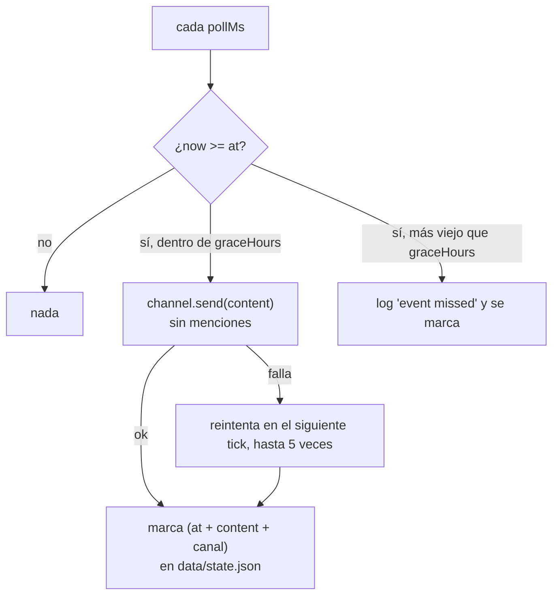

[English](../events.md) · **Español**

# Mensajes programados (eventos)

Hay cosas que el bot dice y que no son reacción a nada: el arranque de un evento del juego, una
fecha, una provocación para el server. `config/event.json` es una agenda chica de **mensajes de una
sola vez** con la hora exacta y los canales que deben recibirlos.

> **Función opcional.** Sin `config/event.json` (o con `enabled: false`) el loop nunca arranca: ni
> timer, ni ruido en el log, y nada más del bot cambia.

## Cómo funciona

Un timer propio (30 s por defecto) compara el reloj con la lista y publica lo que ya venció. Cada
envío se marca en `data/state.json`, así que un reinicio nunca lo repite, y la marca es **por
canal**: una entrada puede publicar el mismo texto en varios canales y solo se saltan los canales que
ya lo recibieron.



Dos decisiones a propósito:

- **Ventana de gracia** (`graceHours`, 12 h por defecto) en vez de "a la hora exacta o nada". Si el
  contenedor está reiniciando, el host está apagado o el deploy llega tarde, el mensaje igual sale
  una vez. Lo que quedó más viejo que la ventana se reporta como perdido y se descarta, así una
  máquina apagada días no escupe un montón de mensajes viejos al arrancar.
- **El texto sale del archivo de config, no de los catálogos de idioma.** Una 🎃 es una 🎃 en todos
  los idiomas; cuando sí quieras una frase, escríbela por idioma en ese archivo.

## Reglas exactas

| Situación | Qué hace el bot |
|---|---|
| Falta para `at` | Nada |
| Ya es `at` o hasta `graceHours` después, sin enviar | Publica el contenido en cada canal de la entrada |
| Ya pasó `at + graceHours` | Registra `event missed` y lo marca; no manda nada |
| Ya estaba marcado para ese canal | Nada (sobrevive a reinicios) |
| Canal inexistente o que no es de texto | Avisa, lo marca y sigue con el resto |
| El envío falla (permisos, 5xx de Discord) | Reintenta en los siguientes ticks, hasta 5 veces; luego loguea error y lo marca |
| El contenido mencionaría a alguien | Nunca hace ping: publica con `allowedMentions: { parse: [] }` |
| Dos entradas vencidas a la vez | Se publican en orden cronológico |

## Configuración

`config/event.json` es local (gitignored y fuera de la imagen, como las demás configs reales); el
repo trae `config/event.example.json`.

```json
{
  "enabled": true,
  "pollMs": 30000,
  "graceHours": 12,
  "events": [
    {
      "at": "2026-10-23T20:00:00-07:00",
      "channels": ["111111111111111111", "222222222222222222"],
      "content": "🎃"
    }
  ]
}
```

| Campo | Obligatorio | Efecto |
|---|---|---|
| `enabled` | sí | Tiene que ser exactamente `true`; cualquier otra cosa deja la función apagada |
| `pollMs` | no | Cada cuánto se revisa el reloj (default `30000`) |
| `graceHours` | no | Cuánto puede atrasarse un mensaje y todavía salir (default `12`; `0` = solo el momento exacto) |
| `events[].at` | sí | Fecha-hora ISO 8601 **con offset** (`-07:00`); sin offset se lee como hora local del contenedor |
| `events[].channels` | sí | Ids de canal (string o array). Puede ser cualquier canal de texto que el bot vea |
| `events[].content` | sí | Texto del mensaje, hasta los 2000 caracteres de Discord |

Las entradas malas se descartan y se reportan como warnings: un error de tipeo en una línea nunca
impide que el bot arranque. El bot necesita **Ver canal** y **Enviar mensajes** en cada canal listado.

## Probarlo sin sustos

1. Elige un canal que nadie mire y pon `at` dos minutos en el futuro.
2. `docker compose restart` (la config se lee una vez al arrancar) y sigue `docker logs -f gameap-bot`:
   al arrancar sale `event watch on: 1 scheduled message(s)` y a la hora, `event sent:`.
3. Para comprobar la idempotencia, reinicia otra vez: no hay segundo mensaje, porque la marca vive en
   `data/state.json`.
4. Borra la entrada de `events.sent` (o la llave dentro de ella) para repetirlo, o quita el archivo
   para apagar la función y reinicia.

## Por qué no un comando slash ni un cron del sistema

- Un comando slash necesitaría que alguien se acuerde de correrlo en el momento justo; de eso se
  trata: de que nadie esté pendiente.
- Un cron del sistema (o `at`) necesitaría el token fuera del contenedor y una segunda copia de los
  ids de canal. El programador dentro del bot ya tiene las dos cosas, y la marca sobrevive a los
  reinicios junto con el resto del estado.
