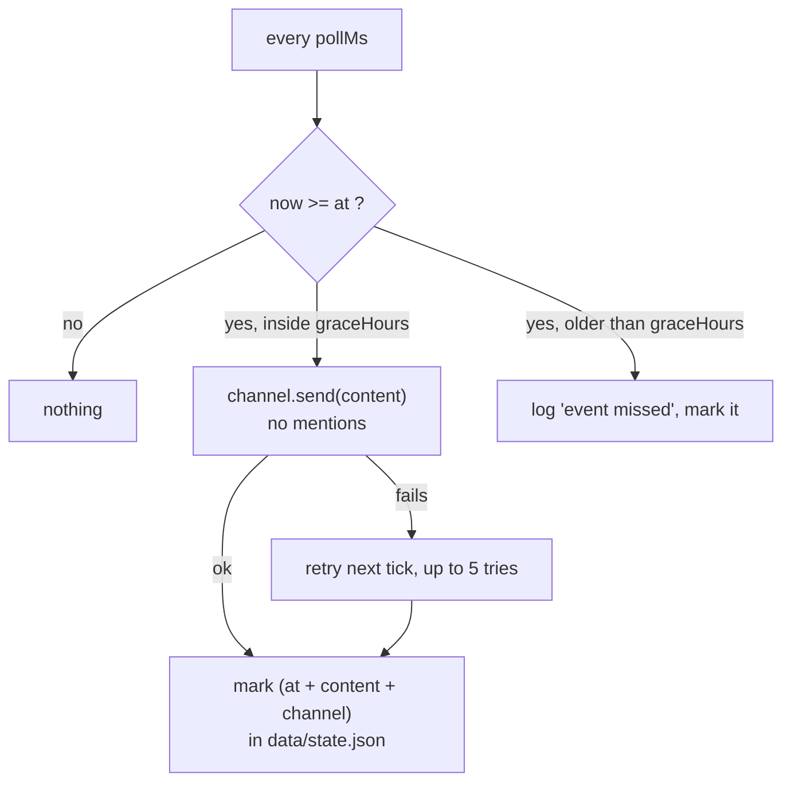

**English** · [Español](es/events.md)

# Scheduled messages (events)

Some things the bot says are not a reaction to anything: an in-game event starting, a date, a tease
for the server. `config/event.json` is a small schedule of **one-shot messages** with the exact time
and the channels that should receive them.

> **Optional feature.** With no `config/event.json` (or `enabled: false`) the loop never starts: no
> timer, no log noise, and nothing else in the bot changes.

## How it works

A timer of its own (30 s by default) compares the clock against the list and posts whatever came due.
Every post is marked in `data/state.json`, so a restart never repeats it, and the mark is **per
channel**: one entry can post the same text in several channels and only the channels that already
got it are skipped.



Two deliberate choices:

- **A grace window** (`graceHours`, 12 h by default) instead of "the exact second or nothing". If the
  container is restarting, the host is off, or the deploy lands late, the message still goes out
  once. Anything older than the window is reported as missed and dropped, so a machine that was off
  for days does not dump a pile of stale messages on the next start.
- **The text comes from the config file, not from the locale catalogs.** A 🎃 is a 🎃 in every
  language; when you do want a sentence, write it once per language in that file.

## Exact rules

| Situation | What the bot does |
|---|---|
| Now is before `at` | Nothing |
| Now is `at` or up to `graceHours` later, not sent yet | Posts the content in every channel of the entry |
| Now is later than `at + graceHours` | Logs `event missed` and marks it; no message |
| Already marked for that channel | Nothing (restart-safe) |
| Channel not found or not text-based | Warns, marks it, keeps going with the rest |
| Post fails (permissions, Discord 5xx) | Retries on the next ticks, up to 5 tries, then logs an error and marks it |
| Content would mention someone | Never pings: posts with `allowedMentions: { parse: [] }` |
| Two entries due at once | Posted in chronological order |

## Configuration

`config/event.json` is local (gitignored and excluded from the image, like the other real configs);
the repo ships `config/event.example.json`.

```json
{
  "enabled": true,
  "pollMs": 30000,
  "graceHours": 12,
  "events": [
    {
      "at": "2026-10-23T20:00:00-07:00",
      "channels": ["111111111111111111", "222222222222222222"],
      "content": "🎃"
    }
  ]
}
```

| Field | Required | Effect |
|---|---|---|
| `enabled` | yes | Must be exactly `true`; anything else keeps the feature off |
| `pollMs` | no | How often the clock is checked (default `30000`) |
| `graceHours` | no | How late a message may still be posted (default `12`; `0` = only the exact moment) |
| `events[].at` | yes | ISO 8601 date-time **with offset** (`-07:00`); without offset it is read as the container's local time |
| `events[].channels` | yes | Channel ids (string or array). It can be any text channel the bot can see |
| `events[].content` | yes | Message text, up to Discord's 2000 characters |

Bad entries are dropped and logged as warnings — a typo in one line never keeps the bot from starting.
The bot needs **View Channel** and **Send Messages** in every channel listed.

## Testing it safely

1. Pick a channel nobody watches and put `at` two minutes in the future.
2. `docker compose restart` (the config is read once at startup) and follow `docker logs -f gameap-bot`:
   `event watch on: 1 scheduled message(s)` at boot, then `event sent:` at the hour.
3. To check idempotency, restart again: no second message, because the mark lives in `data/state.json`.
4. Delete the `events.sent` entry (or the key inside it) to replay, or remove the file to turn the
   feature off and restart.

## Why not a slash command or a system cron

- A slash command would need someone to remember to run it at the right moment; the whole point is
  that nobody is watching.
- A system cron (or `at`) would need the token outside the container and a second copy of the
  channel ids. The scheduler inside the bot already has both, and the mark survives restarts with
  the rest of the state.
